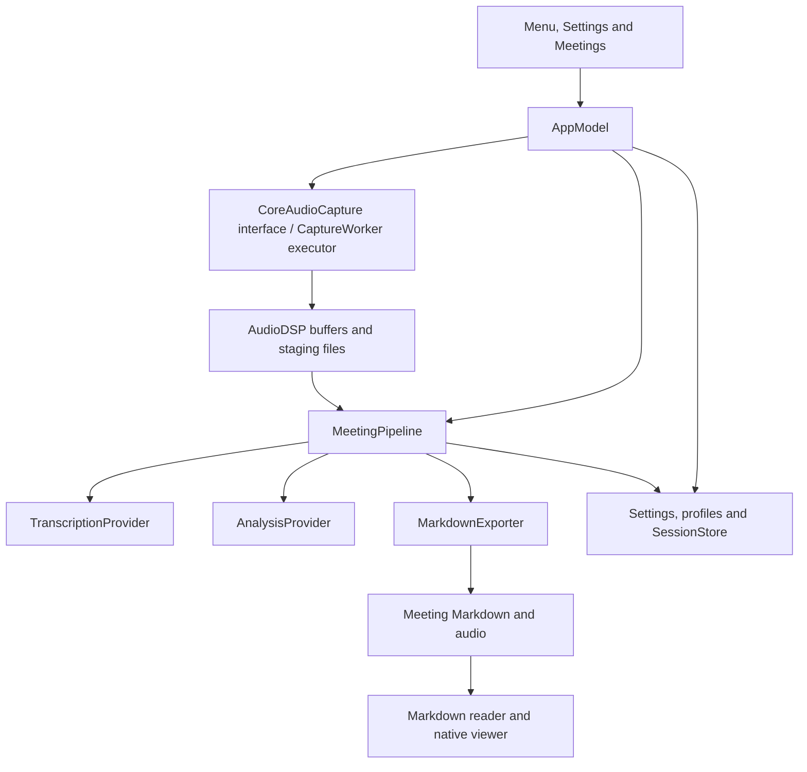

# MeetingNoteTaker architecture

## Purpose and system boundary

MeetingNoteTaker is a native menu bar application for Apple Silicon and macOS 26+. It records microphone and computer audio separately, transcribes meetings, and produces Markdown that can be reviewed or processed by other tools. Transcription and analysis providers are selected independently. The app starts without opening the notebook or Settings.

The application owns capture, processing jobs, model management and export. User-selected folders contain portable meeting documents and audio. Local processing is available; configured server providers introduce explicit network boundaries. No external database service is required.

## Architecture and ownership

The `MeetingNoteTaker` target owns presentation and user actions. `AppModel` coordinates those actions on the main actor. `MeetingCore` owns session models, capture, inference, persistence and document rendering support; it also contains AppKit-based viewer infrastructure, so it is not a platform-independent library. `AudioDSP` supplies C++ audio-buffer operations. The separately built Whisper worker and native inference executables are bundled helpers rather than Swift package targets.

`MeetingPipeline` and `SessionStore` use actors to coordinate processing and persisted state. `ProcessingCoordinator` tracks job ownership so cancelled work cannot update a newer recording.

The main-actor `CoreAudioCapture` interface forwards ordered commands to `CaptureWorker` on a dedicated serial executor (`CaptureControl`). Discovery, health queries, device start/stop and recovery therefore cannot block the UI executor while waiting for an audio service. Commands remain ordered across asynchronous permission requests; stop waits for prior commands and the writer flush. Only callbacks and presentation snapshots return to the main actor. Capture callbacks hand off buffered audio rather than performing inference or document work in the audio path.

The writer batches packet output with bounded buffers while retaining durable five-second checkpoints. Meter work is gated by native menu visibility and capped at ten updates per second. `AudioLevelState` is observed only by the meter views, not the shared app model. Health presentation updates exclude changing timestamps and raw free-byte counts; warnings and status changes still publish. Menu size checks are scheduled only for changed dimensions or native window lifecycle events. Every capture start refreshes microphone and audio-process discovery after permission prompts, independent of the cache; the UI lists also refresh before recording. Hardware discovery during capture uses change notifications plus a five-second cache refresh; health checks remain once per second. See [Development](Development.md#recording-menu-responsiveness) for measurements and validation limits.

## Main processing flows

1. **Record:** reserve matching Markdown/audio filenames, create initial Markdown and snapshot the selected profile and model settings. Capture the microphone through AVAudioEngine and computer audio through an unmuted Core Audio process tap. Persist source timing, capture events and recoverable staging data.
2. **Finalize and transcribe:** finalize staged audio as stereo ALAC M4A, with microphone on the left and computer audio on the right. Optional microphone echo reduction uses computer audio as its reference. Process both sources with the configured transcription provider and save source-labelled, timestamped transcript turns.
3. **Analyze:** read the current transcript from Markdown, apply selected prompt revisions, and run independent analysis types. Long input is budgeted and chunked; structured results and evidence IDs are validated before replacing generated sections. Preserve prior successful results when generation fails.
4. **Review and regenerate:** the native Preview/Raw viewer loads one file snapshot, hides internal markers in Preview and supports evidence navigation. Analysis can be regenerated after audio retention deletes the recording.

Inference is coordinated with recording and memory pressure. Local speech resources are released before built-in analysis loads. Model and prompt snapshots support resumable jobs; explicit regeneration can use updated choices. Source labels identify microphone versus computer audio, not individual remote speakers.

Transcription keeps independent 25-second source chunks and durable checkpoint keys. After extraction to mono 16 kHz floats, optional microphone echo reduction and the speech-energy check, Parakeet receives samples through `InMemoryTranscriptionProvider`. Whisper, Apple Speech and remote providers retain temporary WAV input, cleaned up on success or failure. Both paths share timestamp validation, cancellation and checkpoint/export handling; inference errors never trigger a provider switch. FluidAudio's default seam-timing correction applies inside recognition windows, not across these separate jobs.

## State, storage and external boundaries

| State | Location and responsibility |
| --- | --- |
| Settings, session history, profiles and managed models | `~/Library/Application Support/MeetingNoteTaker`; JSON-based stores and model files |
| Meeting documents and final audio | Configurable folder, default `~/Documents/MeetingNoteTaker`; matching `YYYYMMDD - HHmmss.md` and `.m4a` names with collision suffixes |
| Capture/recovery data | Hidden `.meeting-<session-id>` folder beside the meeting exports |
| Credentials | macOS Keychain; API key and OAuth client-credentials support |
| Model artifacts | Explicit downloads/imports; originals of imported models are preserved |

Profiles contain analysis selections, prompt revisions, output language and default tags. Markdown records profile provenance. Fingerprints, generated-section markers and conflict checks protect external edits and personal notes. Audio retention acts only on eligible app-owned audio after successful transcript export; it must not remove Markdown or models.

Remote transcription sends audio to the configured endpoint. Remote analysis sends transcript text and relevant metadata. Built-in GGUF analysis starts a local llama.cpp server process. Model downloading is another network operation, separate from inference. The application must not silently fall back from a local provider to a remote one.

## Design constraints and extension points

Add speech or analysis backends through the provider interfaces, keeping settings snapshots, cancellation, shutdown and error reporting intact. Extend model catalogs through model-management validation rather than bypassing download receipts or import checks. Keep Markdown evidence references stable when changing rendering or analysis.

Preserve bounded capture buffering, overlapping speech, recoverable partial work and explicit ownership of deleted files. Hardware permissions, device changes and long-call synchronization require live testing beyond unit fixtures. See [Components](Components.md) for source ownership and [Development](Development.md) for validation commands.

## Meeting deletion and search

Meetings can be moved to macOS Trash from the detail header. SessionStore persists a deletion-pending marker, clears queued processing, validates exact owned paths and moves Markdown, audio, staging data and finally the history JSON. Partial failures remain visible for manual retry after restart. Pending/deleted records reject stale saves, and pending records are excluded from inference, recovery and retention. The UI blocks deletion during capture or processing, stops playback before deletion and blocks new work until it finishes. Shared models, settings and profiles are never included.

The sidebar searches known meetings by filename, tags/profile name and current Markdown contents. Searches are debounced, cancellable and performed off the UI thread, with case/diacritic-insensitive terms. No database, persistent index or network is used. App updates and window focus refresh results; unreadable files are reported while filename matches remain available.

Parakeet's speech recovery is explicitly enabled with a 0.5-second minimum gap and seam-timing correction. Normal 25-second jobs enter FluidAudio's internal multi-window recognition path (its single-window limit is 15 seconds at 16 kHz). Gap repair can re-decode interior gaps, including missing opening speech on supported v3-family paths. Short jobs, wholly empty results and audio excluded by the energy check do not necessarily reach this repair pass. Recovery cannot cross independent app job boundaries or recreate audio absent from the recording. Keep current chunking and checkpoint behavior until recognition fixtures demonstrate a benefit from a different approach.
